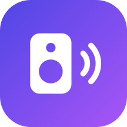
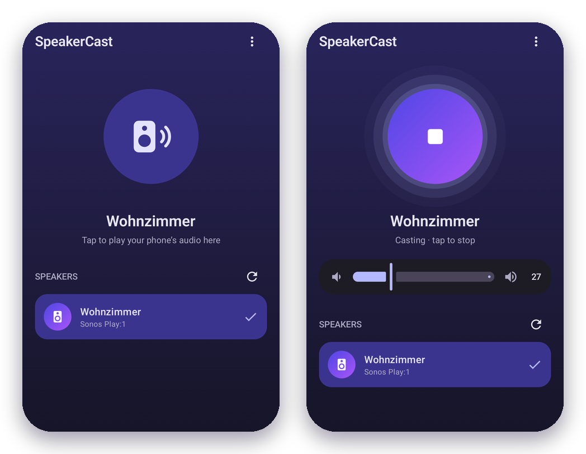

# SpeakerCast

**Your phone's sound, on your Wi‑Fi speaker.** 
One tap. No time limit. No speaker app needed.

 

  

 

Play anything on your phone (YouTube Music, Spotify, podcasts, videos) and hear it on your **Sonos** or any other **UPnP/DLNA** speaker. It's a small, free alternative to *Audio Cast* in BubbleUPnP, without the 15‑minute limit.

<table>
<tr>
<td width="50%" valign="top">

**⚡ One tap** 
The Quick Settings tile casts straight to your last speaker.

</td>
<td width="50%" valign="top">

**∞ No time limit** 
Streams until you stop it, with the screen off too.

</td>
</tr>
<tr>
<td valign="top">

**🔊 Volume keys** 
Control the speaker's volume from your phone, even when it's locked.

</td>
<td valign="top">

**↻ Reconnects by itself** 
A Wi‑Fi hiccup? Playback resumes automatically.

</td>
</tr>
</table>

## Get started

1. **Install** the APK from the [latest release](../../releases/latest).
2. **Open SpeakerCast** and pick your speaker.
3. **Add the tile:** pull down Quick Settings, tap ✏️ and drag *SpeakerCast* in.
4. **Play something**, tap the tile and confirm. That's it.

Tap the tile again to stop. Long‑press it to switch speakers.

## Good to know

- Phone and speaker must be on the **same Wi‑Fi**.
- Android asks for permission **each time** you start. It's the system's screen‑sharing prompt. SpeakerCast only uses the audio.
- The phone goes **quiet** while casting. Turn it up any time if you want both.
- About **half a second of delay**: great for music, less so for lip‑synced video.

Something not working? Tap **⋮ → Share log** in the app and attach the file to an [issue](../../issues).

 

<a href="docs/HOW-IT-WORKS.md">How it works</a> · <a href="LICENSE">MIT License</a> 
Not affiliated with Sonos, Inc.

